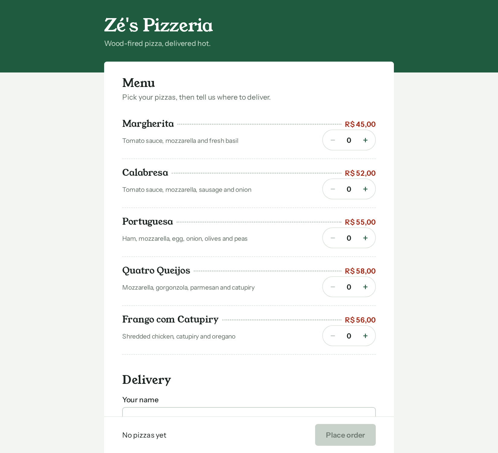
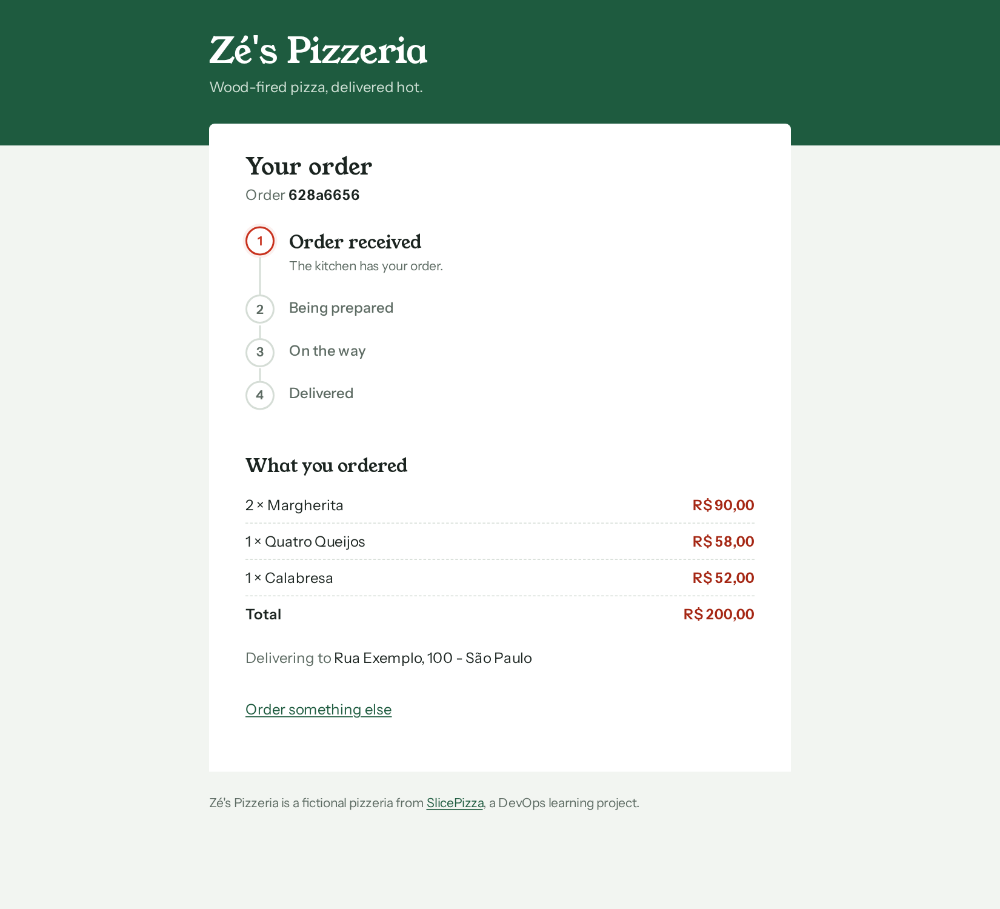
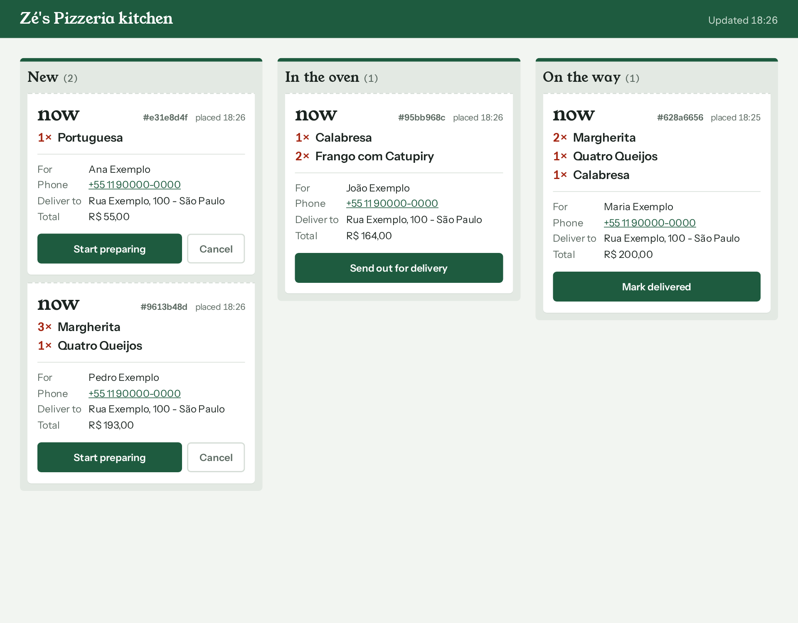

# 🍕 SlicePizza

A **hands-on DevOps learning project**: an online ordering system for a fictional pizzeria, **Zé's Pizzeria**.

The system starts small and grows in **phases**. In each phase, the "pizzeria owner" asks for something new, and that request forces you to learn a new technology: Docker, DNS, cloud, queues, CI/CD, observability, Terraform, Kubernetes...

> The idea is to **feel the problem before using the tool**. We don't use Kubernetes in Phase 1, because the problem it solves doesn't exist yet.

**Um projeto prático de aprendizado de DevOps: o sistema de pedidos online da Pizzaria do Zé, uma pizzaria fictícia.**

📖 **Documentation / Documentação:** https://slicepizza-docs.senatore.tech/ (English · Português)

**Current version:** 1.3.0 · [what changed in each version](https://github.com/SenatoreTeam/SlicePizza/releases) ([`releases.toml`](releases.toml))



| Order status | Kitchen board |
| --- | --- |
|  |  |

> Screenshots show the system running locally with `docker compose up`. All names, phones and addresses are fictional demo data. More in the [product tour](https://slicepizza-docs.senatore.tech/docs/tour).

---

## Architecture (end goal)

```
                                       ┌─ /       ► Menu website (static files)
Customer ──► slicepizza.senatore.tech ─┤
             (HTTPS at the server's    └─ /api/*  ► Orders API ──► Postgres
              proxy, then Caddy)                       │      └────► Redis (cache)
                                                       ▼
                                                Queue (RabbitMQ)
                                                       │
                                                       ▼
                                              Notification worker ──► Telegram

Kitchen ──► slicepizza.senatore.tech/kitchen (login) ──► Caddy ──(kitchen token)──► Orders API
```

Details for each component in [docs/ARCHITECTURE.md](docs/ARCHITECTURE.md).

## Stack

| Component | Technology | Introduced in phase |
|---|---|---|
| Orders API | Python + FastAPI | 1 |
| Database | PostgreSQL | 1 |
| Containers | Docker + Docker Compose | 1 |
| Server | A VPS with Docker, managed with Dokploy | 2 |
| DNS | Cloudflare | 2 |
| Reverse proxy + HTTPS | Caddy | 2 |
| Queue | RabbitMQ | 3 |
| Notifications | Telegram bot | 3 |
| CI/CD | GitHub Actions + GHCR | 4 |
| Observability | Health checks; monitoring is the server's own | 5 |
| Backups and disaster recovery | Whole-VPS backup, by the server's owner | 6 |
| Cache | Redis (optional menu cache) | 7 |
| Scaling | Docker (replicas behind Caddy) + k6 load tests | 7 |
| Security | Trivy, secrets kept out of Git | 8 |

## Repository structure

```
SlicePizza/
├── api/            # Orders API (FastAPI)               → Phase 1
├── worker/         # Notification worker                → Phase 3
├── frontend/       # Menu website + kitchen board       → Phases 2 and 3
├── infra/          # Caddy, load test                   → Phases 2 and 7
├── docs/           # Documentation, roadmap and ADRs
├── docs-site/      # Documentation website (Docusaurus)
├── .github/        # Templates and CI/CD pipelines      → Phase 4
├── docker-compose.yml   # runs everything locally       → Phase 1
└── .env.example         # environment variable template → Phase 1
```

## Getting started

**Prerequisites:** [Git](https://git-scm.com/), [Docker](https://docs.docker.com/get-docker/) with Docker Compose, and Python 3.12 or newer. To work on the documentation site, also [Node.js](https://nodejs.org/) 20 or newer.

1. Clone the repository:
   ```bash
   git clone git@github.com:SenatoreTeam/SlicePizza.git
   cd SlicePizza
   ```
2. Read the [architecture](docs/ARCHITECTURE.md) to understand where the system is headed.
3. Read the [contribution workflow](CONTRIBUTING.md): branches, commits and Pull Requests.
4. Open [Phase 1 of the ROADMAP](docs/ROADMAP.md#phase-1-i-want-to-see-it-running-on-your-computer) to see the task list.

### Running the system (Phase 1)

1. Create your local environment file (it is ignored by Git):
   ```bash
   cp .env.example .env
   ```
2. Build and start everything (menu website, API, Postgres, RabbitMQ and the notification worker):
   ```bash
   docker compose up --build
   ```
   To wait until the stack is healthy before continuing:
   ```bash
   docker compose up -d --wait
   ```
3. In another terminal, check that it is alive:
   ```bash
   curl http://localhost:8000/health
   curl http://localhost:8000/menu
   ```
4. Create an order:
   ```bash
   curl -X POST http://localhost:8000/orders \
     -H "Content-Type: application/json" \
     -d '{
       "customer": {
         "name": "Maria",
         "phone": "+55 11 98888-7777",
         "address": "Av. Paulista, 100"
       },
       "items": [
         { "pizza_id": 1, "quantity": 2 },
         { "pizza_id": 4, "quantity": 1 }
       ]
     }'
   ```

Open the menu website at <http://localhost:8080>: pick pizzas, place an order and follow its status (see [frontend/README.md](frontend/README.md)). Port 8080 is Caddy, the same `web` container that runs in production: it serves the site and forwards `/api/*` to the API, so `http://localhost:8080/api/menu` is the same as `http://localhost:8000/menu` ([ADR 0003](docs/adr/0003-one-domain-caddy-in-front.md)).

Interactive API docs: <http://localhost:8080/api/docs>.

RabbitMQ's management UI runs at <http://localhost:15672> (user and password: `RABBITMQ_USER` / `RABBITMQ_PASSWORD` from `.env`). Every order and status change publishes an event to the `slicepizza.events` exchange ([ADR 0004](docs/adr/0004-order-events-outbox-rabbitmq.md)). The notification worker sends them to Telegram, or writes them to its log when no bot is configured: `docker compose logs -f worker` (see [worker/README.md](worker/README.md)).

The database lives in the `slicepizza_pgdata` named volume, so orders survive `docker compose down` followed by `docker compose up`. Use `docker compose down -v` only when you want to wipe the data.

To stop everything: `docker compose down`.

### Running the tests

The tests use an in-memory SQLite database, so they do not need Docker or Postgres (CI also runs them against Postgres; see [api/README.md](api/README.md#tests)). They need the image's Python, in [`api/.python-version`](api/.python-version), on Linux or macOS; on Windows, see [api/README.md](api/README.md#dependencies):

```bash
cd api
python3 -m venv .venv
source .venv/bin/activate
pip install --require-hashes -r requirements-dev.txt
pytest
```

The worker has its own tests, the same way, from `worker/` (see [worker/README.md](worker/README.md#tests)).

The linter, [ruff](https://docs.astral.sh/ruff/), comes with the dev requirements. Run it from the repository root, where its settings are ([`ruff.toml`](ruff.toml)): `ruff check .` (`ruff check --fix .` fixes what it can).

Every Pull Request runs the [pipeline](.github/workflows/ci.yml): lint, then the tests, then the images. On `main`, the images are published only when everything passed ([ADR 0008](docs/adr/0008-one-gated-pipeline.md)).

## Documentation

The documentation site, built with [Docusaurus](https://docusaurus.io/), lives in [`docs-site/`](docs-site/). It needs Node.js 20 or newer. To run it locally:

```bash
cd docs-site
npm install
npm start                      # English
npm start -- --locale pt-BR    # Brazilian Portuguese
```

The site is served at http://localhost:3000/, or at http://localhost:3000/pt-BR/ with `--locale pt-BR` (the dev server runs one language at a time; the published site has a language menu). The published version is at https://slicepizza-docs.senatore.tech. Build the static version with `npm run build`. The ADRs on the site are rendered straight from [`docs/adr/`](docs/adr/).

## Roadmap

| Phase | Zé's request | Status |
|---|---|---|
| 1 | "I want to see it running on your computer" | ✅ Done |
| 2 | "I want the site live on my own domain" | ✅ Done |
| 3 | "Customers want to know when their pizza is on the way" | ✅ Done |
| 4 | "Every time you change something, something breaks" | ✅ Done |
| 5 | "The site went down Friday night and nobody noticed" | ✅ Done |
| 6 | "The server died and we lost the orders" | ✅ Done |
| 7 | "We're running a R$20 pizza promo on Friday" | ✅ Done |
| 8 | "I heard hackers attack pizzerias" | ✅ Done |

Tasks and definition of done for each phase in [docs/ROADMAP.md](docs/ROADMAP.md).

## Ground rules

1. **Everything lives in Git.** From Phase 6 on, making changes directly on the server is not allowed: what runs there is described in Git (compose files and `.env.example`), and what lives only on the server is backed up with it by the server's owner.
2. **Nothing goes straight to `main`.** Every change goes through a Pull Request (see [CONTRIBUTING.md](CONTRIBUTING.md)).
3. **Every important decision becomes an ADR** in [docs/adr/](docs/adr/). For example: "why RabbitMQ and not Redis?".
4. **Secrets never go into Git.** Use the `.env` file (it's in `.gitignore`).
5. **When a phase is done, update this README** (diagram, stack and roadmap).

## License

[Apache 2.0](LICENSE)
